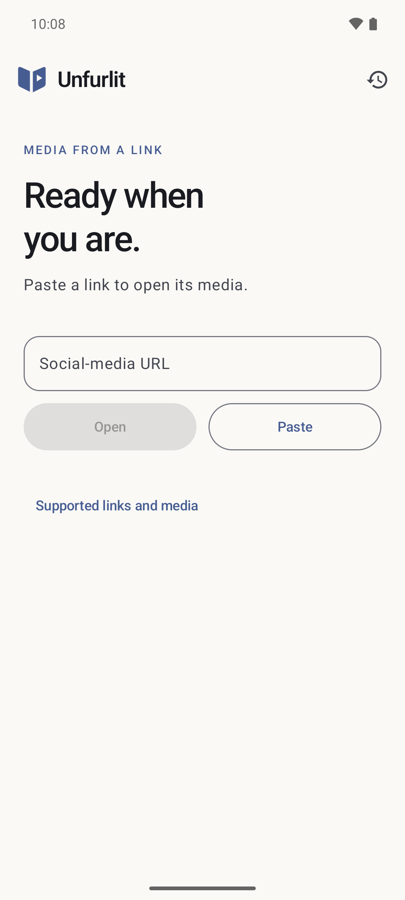
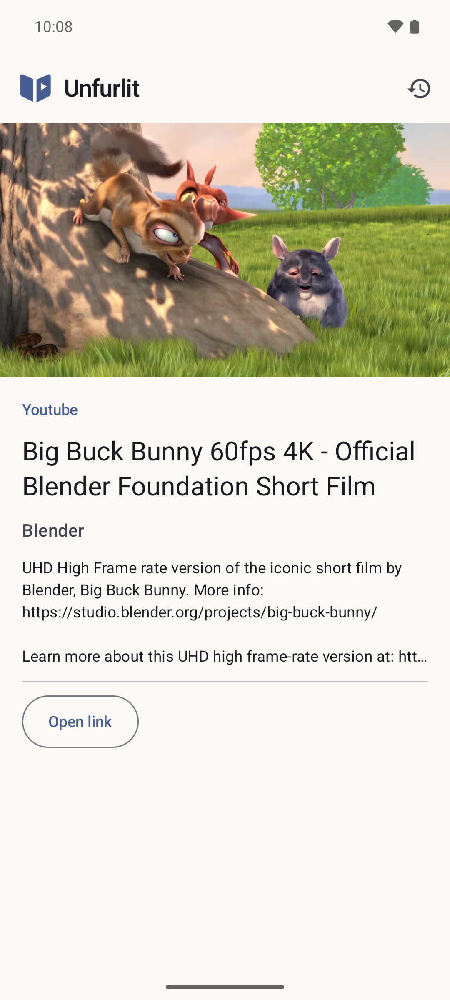
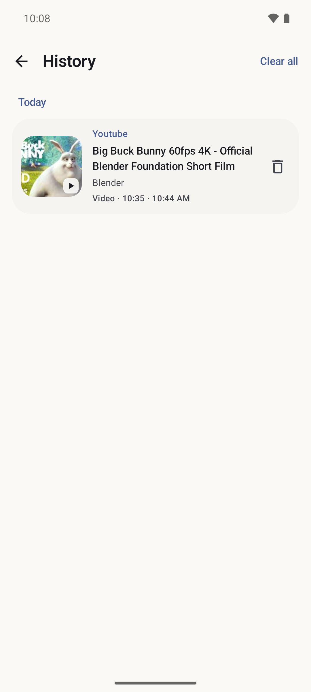
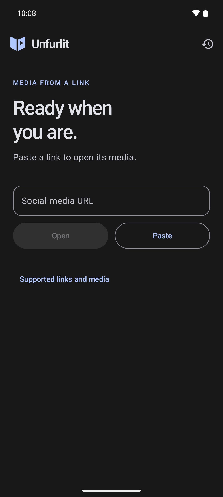

# Unfurlit

Watch videos, view photos, and play audio from social links in a native Android viewer.
Paste a link or share it to Unfurlit to open its media without using the official app or the limited online website.

Or download the APK from [GitHub Releases](https://github.com/originalRecipe1/unfurlit/releases) ([install details](docs/usage.md#installation)).
**Android 7.0+, 64-bit ARM only** · [Privacy](PRIVACY.md) · [Documentation](docs/README.md)

| Open a link | Watch | Revisit | Dark mode |
| :---: | :---: | :---: | :---: |
|  |  |  |  |

## Features

- Open public links from popular video, photo and audio sites; see [compatibility](#compatibility).
- Open supported links tapped in other apps directly in Unfurlit; see [how to turn it on](docs/usage.md#open-links-directly-in-unfurlit).
- Watch fullscreen videos and audio, zoom into photos, with gallery/carousel support.
- Revisit media in **local history**.

Media extraction runs **on your device**, with no account, backend or ads.

## Compatibility

| Site | Video | Photos / galleries | Audio | Status |
| --- | --- | --- | --- | --- |
| YouTube | ✅ watch, `youtu.be`, Shorts | — | — | ✅ Works |
| Vimeo | ✅ page, player, unlisted | — | — | ✅ Works |
| Instagram | ✅ posts, Reels, carousels | ✅ single, multi-photo, carousels | no photo-post soundtrack | ✅ Works |
| TikTok | ✅ | ✅ photo posts | ✅ photo-post soundtrack | ✅ Works |
| Reddit | — | direct image links only | — | ⚠️ Posts blocked for signed-out apps¹ |
| X/Twitter | ✅ including GIFs | ✅ including mixed posts | — | ✅ Works |
| PeerTube | ✅ | — | — | ✅ Works |
| Bandcamp | — | — | ✅ tracks | ✅ Works |
| Tumblr | ✅ including YouTube/Vimeo embeds | ✅ including mixed posts | — | ✅ Works |
| Pixiv | — | ✅ illustrations, no Ugoira | — | ✅ Works |
| Imgur, Bluesky, Flickr, others | ✅ e.g. Imgur GIFV, Bluesky, Twitch clips | ✅ e.g. Imgur albums, Bluesky, Flickr, Mastodon, Pinterest | ✅ e.g. SoundCloud, Mixcloud | ✅ Works for tested sites |

¹ Since 2026-10-14 Reddit blocks signed-out apps, so Unfurlit shows a Reddit message with
**Open link** for posts. Direct `i.redd.it`, `preview.redd.it` and `reddit.com/media` image
links still opened in the 2026-10-16 run. See the
[dated note](docs/social-link-baseline.md#reddit-signed-out-block--2026-10-14).

— means no test fixture covers it, not that it fails. Public posts only; availability
varies by post, region and platform changes. [Sites and access](docs/usage.md#sites-and-access)
explains extraction engines and limitations.

Last checked: 1.4.4 candidate, 2026-10-28, 62 pass / 10 Reddit blocked / 1 fail of 73 fixtures; Dailymotion now needs browser impersonation, which the app does not bundle. Extraction, not full playback.
[2026-10-28 run](docs/releases/1.4.4-phone-test.md#prep-time-checks--2026-10-28) · [Baseline](docs/social-link-baseline.md#143--2026-10-25) · [1.4.3 phone record](docs/releases/1.4.3-phone-test.md)

## Contributing

Issues and pull requests are welcome: [Issues](https://github.com/originalRecipe1/unfurlit/issues) · [Pull requests](https://github.com/originalRecipe1/unfurlit/pulls).
Bug reports should include a public example link and the app version; never post private links, cookies or credentials.
Report security issues as described in [SECURITY.md](SECURITY.md).

[Build from source](docs/development.md#build) · [GPL-3.0-only](LICENSE)
